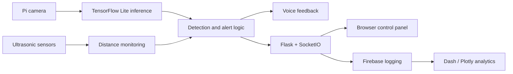

# VisionCap — AI-Powered Smart Hat

A research prototype for assistive navigation that combines **on-device object detection**, **ultrasonic sensing**, **voice feedback**, and a **browser-based control panel** on Raspberry Pi.

> **Status:** Research prototype. This repository preserves experimental hardware-dependent code; it is not a plug-and-play production deployment or a substitute for a mobility aid.

## What it does

- Uses a Raspberry Pi camera and a TensorFlow Lite object detector to identify objects in front of the wearer.
- Uses multiple ultrasonic sensors for close-range obstacle awareness.
- Exposes Flask routes for detection, configuration, video streaming, and a control interface.
- Uses Flask-SocketIO for real-time application communication.
- Includes dashboards built with Dash/Plotly and Firebase-backed event logging.
- Integrates spoken alerts and navigation-related browser controls.

## System architecture

## Technology

**Hardware:** Raspberry Pi, Pi Camera, ultrasonic sensors  
**ML:** TensorFlow Lite, OpenCV, MobileNet-based object detection  
**Backend:** Python, Flask, SocketIO  
**Telemetry:** Firebase / Firestore  
**Dashboard:** HTML, JavaScript, Dash, Plotly

## Where to find the code

The main application is under:

`smart hat code/working smart_hat/final_hat_code/`

Important files include:

- `new_app.py` — Raspberry Pi application, hardware integrations, Flask endpoints, and analytics.
- `control_panel.html` — browser control interface.
- `sensor.js`, `navigation.js` — client-side sensor and navigation interactions.

**Note:** A file named `readme` inside `final_hat_code` also contains executable Python-like source; it is **not** the main Markdown documentation.

## Running the prototype

This project requires compatible Raspberry Pi hardware and configuration. It **cannot be launched on an ordinary laptop without modification**.

1. Install Raspberry Pi OS and configure the camera and ultrasonic GPIO connections.
2. Install compatible versions of the Python libraries imported by `new_app.py` (including `picamera2`, TensorFlow Lite runtime, OpenCV, Flask, SocketIO, Dash, and Firebase Admin).
3. Supply the TensorFlow Lite model, COCO label file, and Firebase service-account credentials **outside version control**.
4. Review the paths currently hardcoded for the original Raspberry Pi installation (such as `/home/ada/de/`). Adapt them to your environment before starting.
5. Review the application security settings before exposing any HTTP endpoint. Do not publicly expose debug mode, unrestricted CORS, or shutdown/configuration routes.

A reproducible installer, hardware wiring guide, and automated hardware test suite are future improvements, not current guarantees.

## Project limitations and engineering roadmap

- The original code couples camera access, GPIO, application routes, and analytics in large scripts.
- Hardware and credential paths are environment-specific.
- Hardware-free simulation, automated regression tests, configuration management, and modular packaging are not yet established in this repository.
- The long-term refactor can separate `hardware/`, `inference/`, `api/`, `web/`, and `telemetry/` while preserving the working Pi implementation.

See [architecture and safe refactor plan](docs/architecture.md).

## AI classification

This project uses **computer vision / edge inference**. It is **not currently an LLM or multi-agent system**. Keeping this distinction clear makes the portfolio more technically credible.

## Research context

VisionCap originated as research into real-time assistive navigation for visually impaired individuals. For academic claims and benchmarks, cite measured results and supporting papers in future documentation rather than inferring performance from source code alone.
